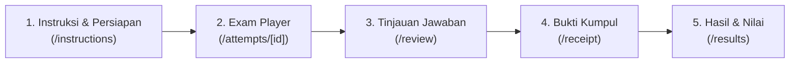

# UjianKita — Student Examination Experience (UX) Architecture

This document specifies the end-to-end Student Examination User Experience (UX) designed and implemented in **Phase A** of UjianKita, prioritizing test reliability, minimal cognitive load, thumb ergonomics, and zero data loss.

---

## 1. Design Principles for Student CBT

1. **Zero Data Loss Guarantee:** A student must never lose an entered answer due to network interruption, battery depletion, or accidental navigation. The UI honestly communicates save state and queues unsaved answers locally in IndexedDB until acknowledged by the server.
2. **Reduced Cognitive Load:** The interface removes unnecessary decorations, complex sidebars, and distracting UI animations. The examination layout focuses 100% of student attention on the current question stem and options.
3. **Ergonomic Thumb-Driven Navigation:** On mobile smartphones, primary navigation actions (Previous, Question Palette, Next, Flag) are placed within the natural thumb sweep zone in the lower third of the screen.
4. **Legible Typography & High-Contrast Touch Targets:** Question text is presented with generous line height (1.6) and comfortable font sizing. Touch options have a minimum height of 56px to prevent mis-taps.
5. **No False Reassurance:** If an answer has not yet been confirmed by the server, the interface explicitly displays "Menyimpan ke perangkat..." or "Menunggu sinkronisasi", never falsely claiming an uncommitted answer is safely saved on the server.

---

## 2. Examination Flow & Screen Architectures

### 2.1. Screen 1: Examination Instructions & Device Preparation
- **Route:** `/student/exams/[examId]/instructions`
- **Purpose:** Pre-flight checklist before starting the authoritative examination timer.
- **Key UX Elements:**
  - Clear summary banner: Subject, Exam Title, Total Duration (minutes), Total Questions, and Passing Grade (KKM).
  - Explicit Examination Rules: Number of permitted attempts, prohibited actions (tab switching, reloading, copying text), and Safe Exam Browser requirements if enforced.
  - Large primary call-to-action button: `Mulai Ujian Sekarang` (min-height 48px), which requests attempt creation and redirects to the Exam Player.

### 2.2. Screen 2: Exam Player Interface
- **Route:** `/student/attempts/[attemptId]`
- **Structure:**
  - **Compact Sticky Top Header:**
    - Height: exactly 56px on mobile, preventing screen waste.
    - Left: Question number indicator (`Soal 1 dari 40`) and Flag toggle (`Tandai Ragu` with amber styling).
    - Center/Right: Prominent countdown timer with color-coded warning (< 5 minutes turns amber, < 1 minute turns red with subtle pulse).
    - Save Status Pill: Live indicator showing `Tersimpan di server` (green check), `Menyimpan...` (spinning loader), or `Tersimpan di perangkat (offline)` (amber cloud-off).
  - **Question Display Area:**
    - Type badge: `Pilihan Ganda`, `Pilihan Jamak`, `Benar / Salah`, or `Esai`.
    - Points badge: `[X Poin]`.
    - Question stem: Rendered using `QuestionContentRenderer` with full support for paragraphs, bold/italic text, math formulas via KaTeX, and responsive embedded images.
  - **Options Area (Multiple Choice & True/False):**
    - Large 56px touch target cards (`min-h-[56px] p-4`).
    - Letter indicator circle (`A`, `B`, `C`, `D`, `E`) that turns solid blue (`bg-blue-600 text-white`) when selected.
    - Radio / Checkbox indicator with accessible `aria-checked` states.
  - **Options Area (Essay Questions):**
    - Accessible auto-resizing textarea with `min-h-[160px] text-base p-4`.
    - Live character and word count indicators.
    - Autosave notice informing students that keystrokes are automatically debounced and saved.
  - **Unified Bottom Navigation Bar:**
    - Fixed sticky at screen bottom on mobile (`fixed inset-x-0 bottom-0 z-30 pb-safe bg-white/95 backdrop-blur-sm`).
    - Single DOM implementation to prevent multi-element query conflicts in automated tests.
    - Left: `Sebelumnya` (Previous button).
    - Center: `Soal X/Y` button which opens the mobile question palette modal.
    - Right: `Berikutnya` (Next button) on questions 1 to N-1; switches to `Tinjau Jawaban` (Review button) on the final question.
  - **Question Palette Modal (Mobile):**
    - Accessible dialog (`role="dialog" aria-modal="true"`) displaying a 5-column grid of all question numbers.
    - Color legend:
      - Green with border: Answered (`Sudah dijawab`).
      - Amber with flag icon: Flagged for review (`Ragu-ragu`).
      - White with gray border: Unanswered (`Belum dijawab`).
      - Blue outline: Current active question (`Sedang dibuka`).
    - One-tap jump to any question with immediate drawer dismissal.

### 2.3. Screen 3: Examination Review
- **Route:** `/student/attempts/[attemptId]/review`
- **Purpose:** Comprehensive check before final, irreversible submission.
- **Key UX Elements:**
  - Metric summary cards: Total questions, Answered count, Flagged count, and Unanswered count.
  - Highlighted warning banner if there are unanswered questions or questions marked as doubtful.
  - Interactive question grid allowing 1-tap navigation directly back to any specific question in the player.
  - Confirmation Modal: Double-check modal before initiating the atomic `POST /api/student/attempts/[attemptId]/submit` request.
  - Submission button has strict debounce to prevent accidental double-submission under flaky mobile network conditions.

### 2.4. Screen 4: Official Submission Receipt
- **Route:** `/student/attempts/[attemptId]/receipt`
- **Purpose:** Proof of completed examination submission for the student and school proctors.
- **Key UX Elements:**
  - Prominent checkmark badge: `Ujian Berhasil Dikumpulkan`.
  - Cryptographic Receipt Code: Formatted in bold monospaced text (e.g., `UK-REC-892410-XYZ`).
  - Metadata grid: Submission timestamp (formatted in school's local timezone), Subject name, Exam title, Student NIS, and Class.
  - Print / Save as PDF action button for offline student archival.
  - Direct navigation button back to the student dashboard.

### 2.5. Screen 5: Results & Score Transparency
- **Route:** `/student/results`
- **Purpose:** View finalized grades and assessment breakdown.
- **Key UX Elements:**
  - Released state: Displays final percentage score, total points earned vs maximum points, passing status (`Tuntas` in emerald badge or `Belum Tuntas` in amber badge), and breakdown of objective vs manual teacher grading.
  - Withheld state: If the teacher has not yet finalized manual grading or released grades, displays a clean notice: `Nilai belum dirilis oleh guru mata pelajaran`.
  - Direct link to view the associated official submission receipt.

---

## 3. Reliability & Forensic Security Features

1. **Forensic Watermark (`StudentExamWatermark`):**
   - Renders a subtle semi-transparent repeating watermark grid across the exam workspace with the student's name, attempt ID, and timestamp.
   - Configured with `aria-hidden="true"` and `pointer-events-none` so that it never interferes with screen readers, assistive tools, or student touch interactions.
2. **Context-Menu & Copy-Paste Guard:**
   - Scoped strictly to the question stem area to prevent test leaking, without interfering with typing or pasting inside essay response fields.
3. **Server-Authoritative Time Sync:**
   - The countdown timer periodically syncs with `GET /api/student/attempts/[attemptId]/time` every 60 seconds to prevent client-side device clock skew from terminating an exam prematurely or granting unauthorized extensions.
