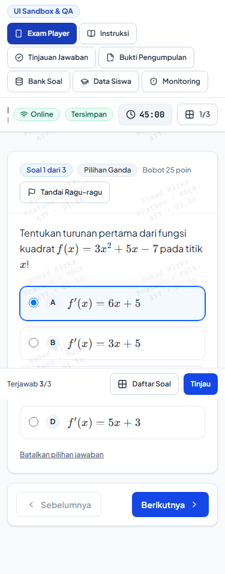
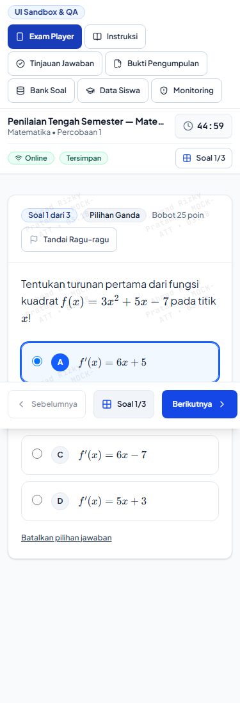
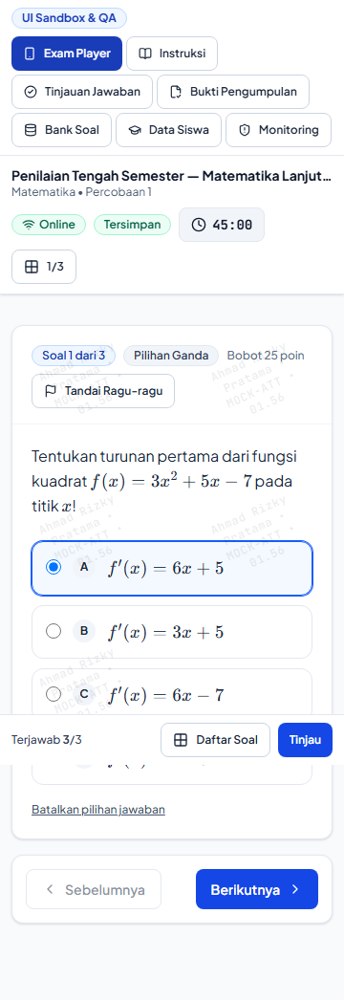
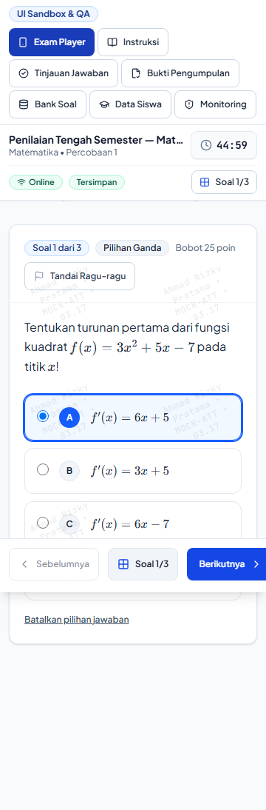
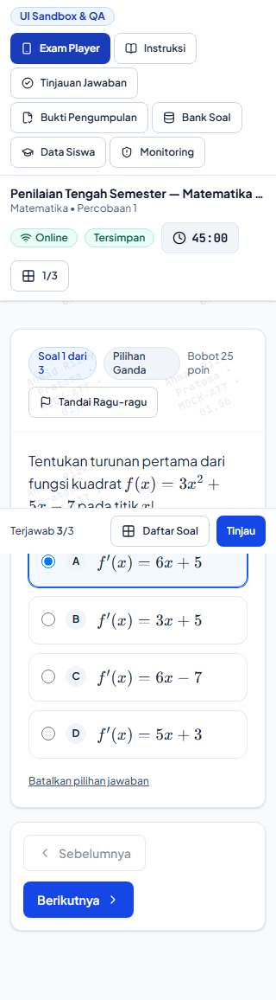
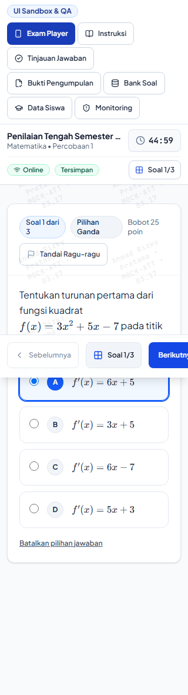
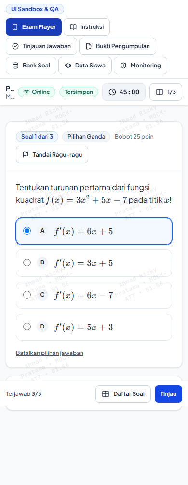
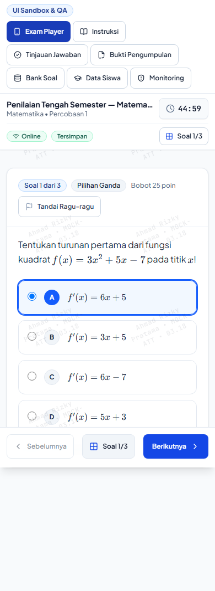
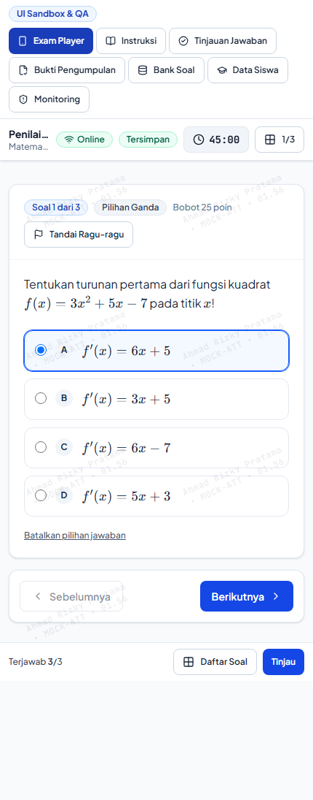
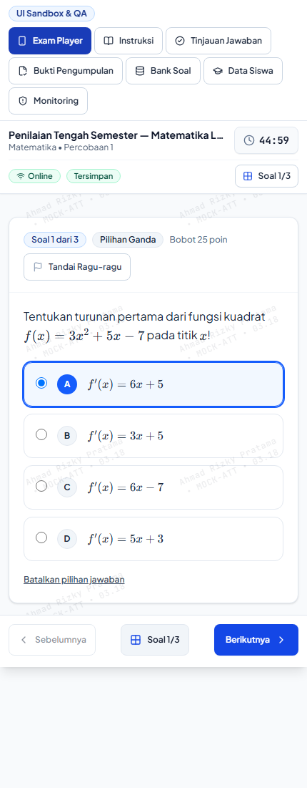

# Visual Comparison Contact Sheet: Student Exam Player (Mobile Viewports)

This contact sheet presents side-by-side and paired before-and-after visual inspections of the **Student Exam Player (`ExamPlayerClient`)** across all 5 supported mobile viewports:
- 320px (Compact Android / Feature Phones)
- 360px (Mainstream Android Entry-Level)
- 375px (Standard iPhone SE / 8 / Mini)
- 390px (Modern Mobile iPhone 12/13/14 / Pixel 7)
- 430px (Large Screen Mobile iPhone Pro Max / Plus)

---

## 1. 375px Standard iPhone (Primary Mobile Benchmark)

### Baseline vs Redesign Comparison

| Baseline (Phase 6.5) | Redesign (Phase A.1 Hardened) |
| :---: | :---: |
|  |  |

### Key Improvements & Visual Deltas
1. **Compact Sticky Header (56px):**
   - **Baseline:** Double-deck header with redundant metadata and tall heights (92px), consuming over 20% of the vertical viewport.
   - **Redesign:** Single compact 56px sticky bar with truncated exam title, attempt index, network status, authoritative autosave badge (`Tersimpan`), and quick palette trigger button (`Soal 1/3`).
2. **56px Minimum Tap Target Option Cards:**
   - **Baseline:** Compact standard radio options with tiny text and tap hitboxes (< 32px), creating frequent mis-taps on capacitive touchscreens.
   - **Redesign:** Full-width rounded card container with 56px minimum height, large circular letter badge (`A`, `B`, `C`, `D`), active ring states (`ring-2 ring-blue-700 bg-blue-50/50`), and `cursor-pointer`.
3. **Unified Sticky Bottom Action Bar:**
   - **Baseline:** Navigation buttons scrolled out of view at the bottom of long stems, forcing students to scroll down after every question.
   - **Redesign:** Pinned sticky action bar with `fixed inset-x-0 bottom-0 z-30 pb-safe`, containing large 44px tap targets for "Sebelumnya", "Nomor Soal", and "Berikutnya" / "Tinjau & Kumpulkan".
4. **Bottom Content Clearance:**
   - `<main>` scroll container includes `pb-24 lg:pb-8` clearance, ensuring long stems, formulas, and essay textarea notes never get obscured behind the sticky bottom navigation bar.

---

## 2. 360px Compact Android (Indonesian School Standard)

| Baseline (360px) | Redesign (360px) |
| :---: | :---: |
|  |  |

### Visual Deltas & Mobile Verifications
- **Zero Horizontal Blowout:** Document scroll width matches client width exactly (`360px == 360px`).
- **LaTeX Math Containment:** KaTeX equations render with localized `overflow-x-auto overflow-y-hidden` and inline-block containment, preventing equation clipping or page blowout.
- **Font Sizing Hygiene:** All interactive form fields and question stems use 16px (`text-base`) font size to prevent automatic browser zoom on mobile viewports.

---

## 3. 320px Small Android / Extreme Constraint

| Baseline (320px) | Redesign (320px) |
| :---: | :---: |
|  |  |

### Visual Deltas & Extreme Constraint Resilience
- **Truncation & Ellipsis:** Title and subject text neatly truncate without overflowing the header flexbox.
- **Badges:** Save status badge shrinks text cleanly to 11px while maintaining readability.
- **Flag Button:** "Tandai Ragu-ragu" gracefully displays flag icon and compact label without overlapping question weight badges.

---

## 4. 390px Modern Mobile (Pixel 7 / iPhone 13/14/15)

| Baseline (390px) | Redesign (390px) |
| :---: | :---: |
|  |  |

### Visual Deltas
- Generous reading typography with high-contrast text (`text-slate-900` on `bg-white`).
- Smooth button focus rings (`ring-2 ring-blue-600 ring-offset-2`).
- Timer badge font rendered in monospace (`font-mono`) to prevent visual jitter when seconds tick.

---

## 5. 430px Large Mobile (iPhone 14/15/16 Pro Max)

| Baseline (430px) | Redesign (430px) |
| :---: | :---: |
|  |  |

### Visual Deltas
- Balanced whitespace margins (`px-4 sm:px-6`).
- Option cards utilize full container width while maintaining optimal line length for readability.
- Floating modal dialog for question palette fits comfortably within 85vh height with clean thumb navigation.
