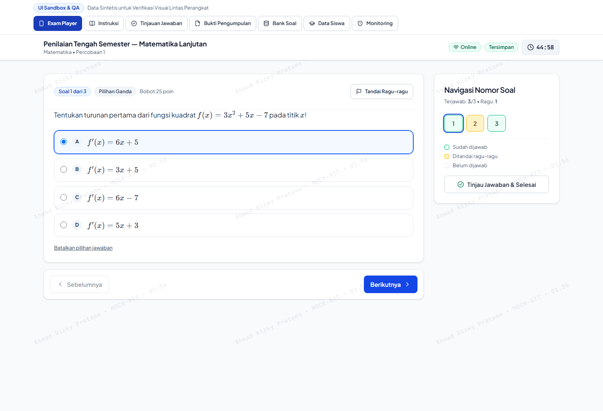
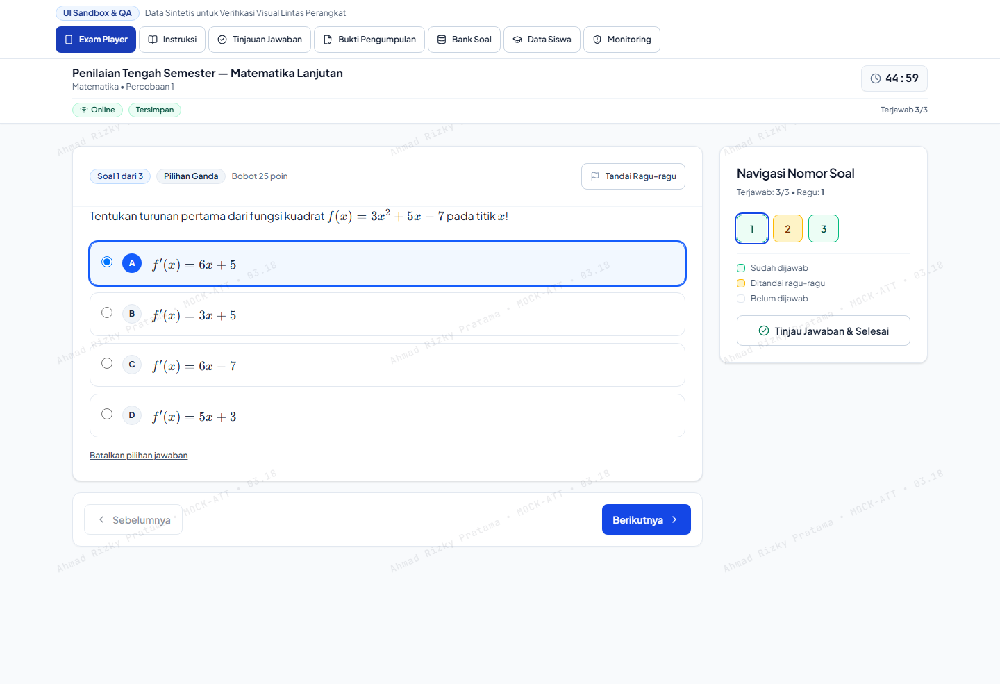
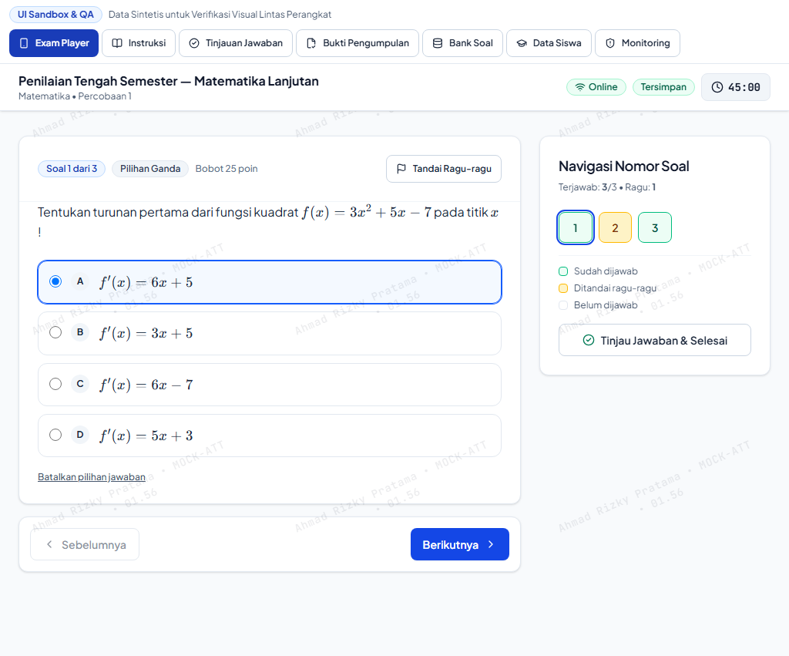
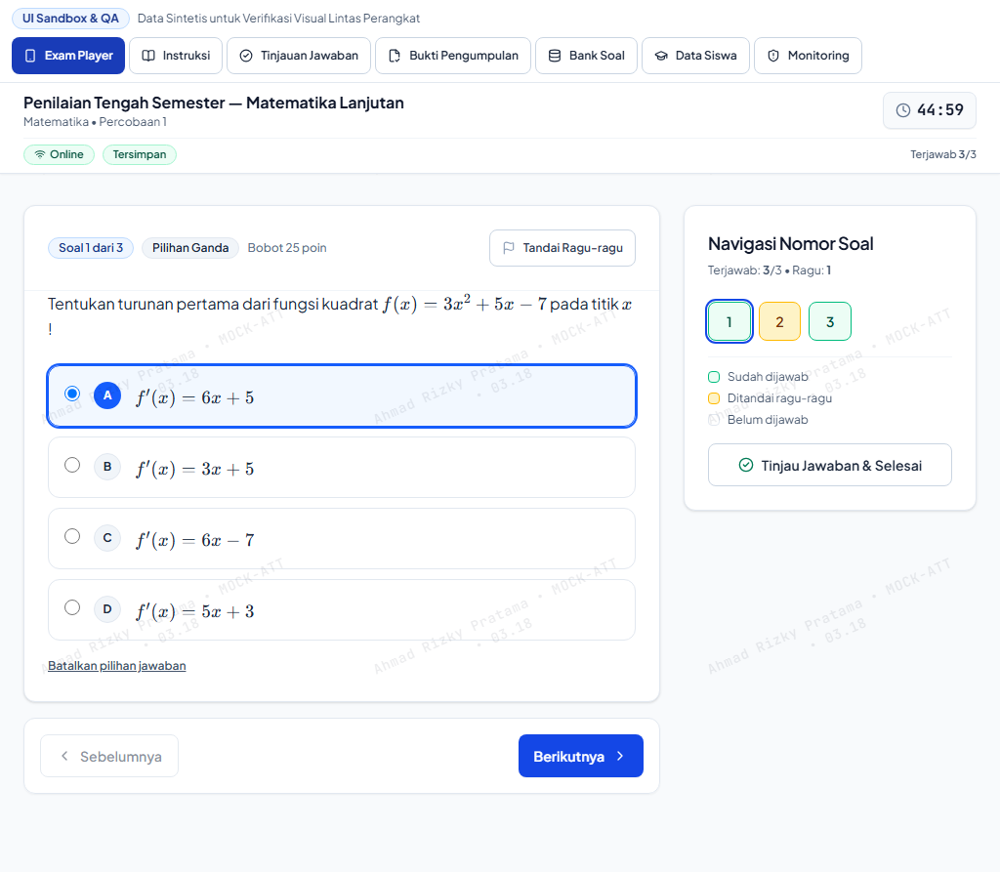
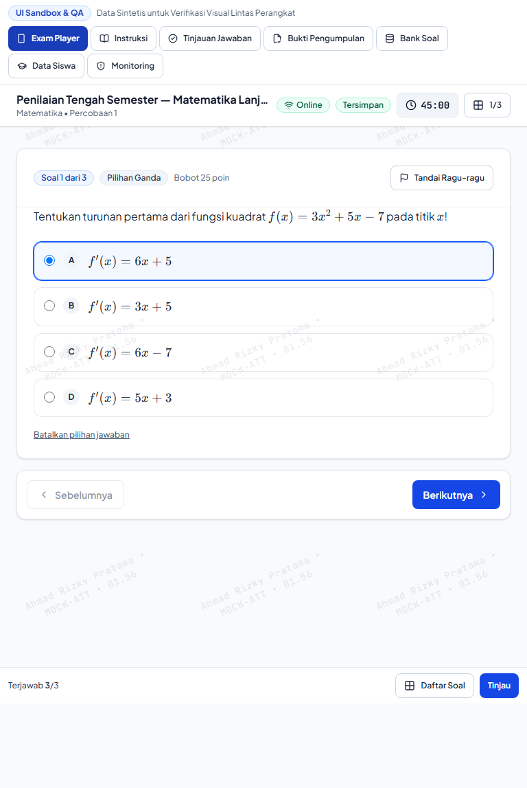
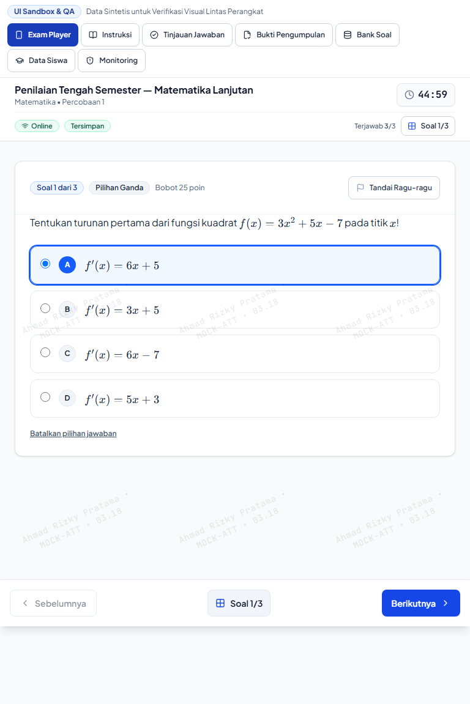

# Visual Comparison Contact Sheet: Student Exam Player (Tablet & Desktop)

This contact sheet presents side-by-side visual comparisons of the **Student Exam Player (`ExamPlayerClient`)** across tablet and large-screen viewports:
- 768px (Tablet Portrait — iPad / Android Tablet)
- 1024px (Tablet Landscape / Small Laptop)
- 1440px (Standard Desktop CBT Computer Lab Monitor)

---

## 1. 1440px Desktop (Primary CBT Lab Benchmark)

### Baseline vs Redesign Comparison

| Baseline (Phase 6.5) | Redesign (Phase A.1 Hardened) |
| :---: | :---: |
|  |  |

### Key Improvements & Visual Deltas
1. **Persistent Question Palette Sidebar (`grid-cols-[minmax(0,1fr)_300px]`):**
   - **Baseline:** Navigator sidebar floated ambiguously and lacked sticky positioning, scrolling out of view on long questions.
   - **Redesign:** 300px right-hand sidebar pinned with `sticky top-20`, rendering 5-column numbered grid of question buttons with three distinct color states:
     - Answered: Emerald border (`border-emerald-500 bg-emerald-50 text-emerald-900`)
     - Flagged: Amber border (`border-amber-400 bg-amber-100 text-amber-900`)
     - Unanswered: Slate border (`border-slate-200 bg-white text-slate-700`)
     - Active Question: High-visibility focus ring (`ring-2 ring-blue-700 ring-offset-1`).
2. **Static Integrated Desktop Navigation Bar:**
   - **Baseline:** Clunky detached buttons floating over the viewport edge.
   - **Redesign:** Clean rounded card container (`lg:static lg:rounded-xl border border-slate-200 shadow-xs`) positioned directly below the active question card.
3. **Forensic Watermark Integration:**
   - Subtle diagonal forensic watermark (`StudentExamWatermark`) renders in background with strict pointer-events none (`pointer-events-none`) and opacity 0.08, protecting examination integrity without obstructing reading.

---

## 2. 1024px Small Laptop / School Chromebook

| Baseline (1024px) | Redesign (1024px) |
| :---: | :---: |
|  |  |

### Visual Deltas
- Compact typography hierarchy preventing awkward line breaks in question stems.
- Palette summary counts (Terjawab / Ragu-ragu) clearly readable above question grid.
- Full contrast compliance between card background (`#ffffff`), border (`#e2e8f0`), and option text (`#0f172a`).

---

## 3. 768px Tablet Portrait (iPad 10.2" / Android Tab)

| Baseline (768px) | Redesign (768px) |
| :---: | :---: |
|  |  |

### Visual Deltas & Responsive Breakpoints
- Smooth transition between mobile single-column layout and multi-column grid.
- Bottom navigation bar remains conveniently accessible for thumb touch while holding tablet in portrait orientation.
- Question palette opens in bottom sheet with comfortable touch targets (48x48px per numbered cell).
