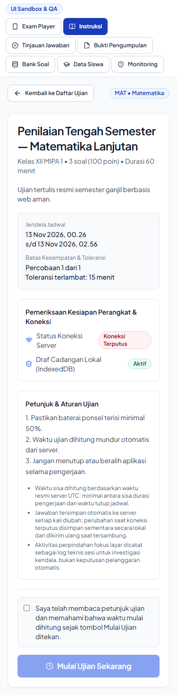
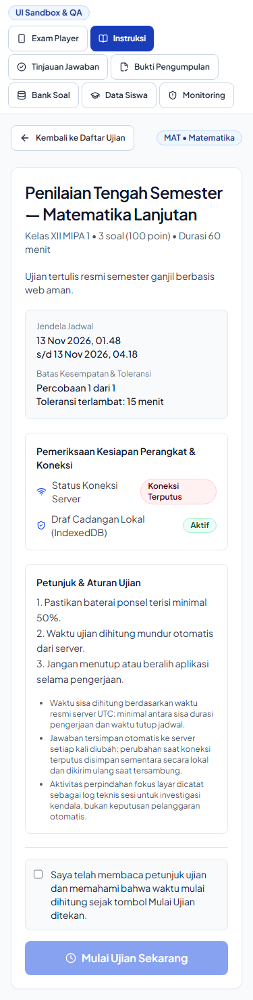
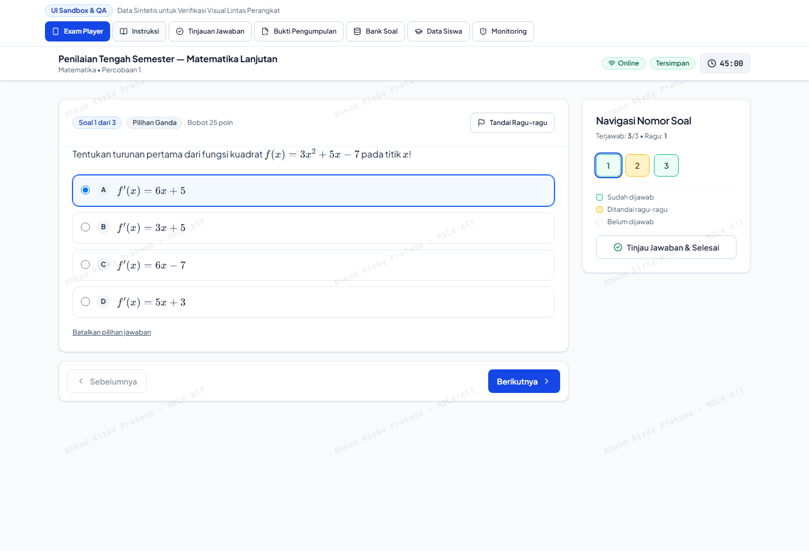
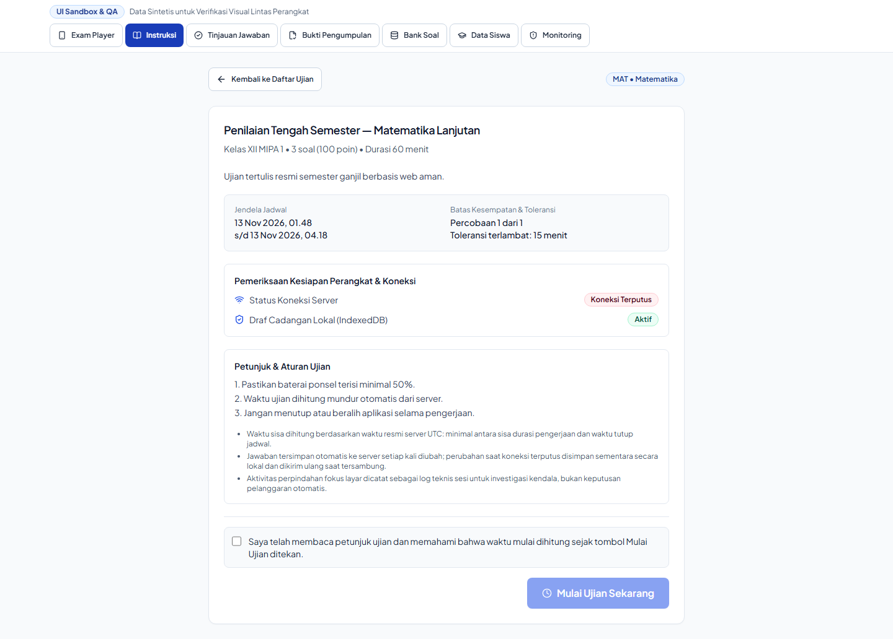
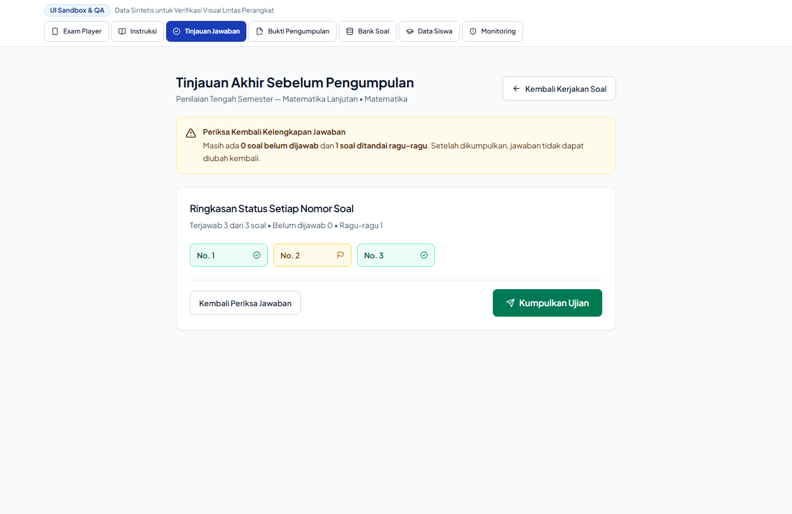
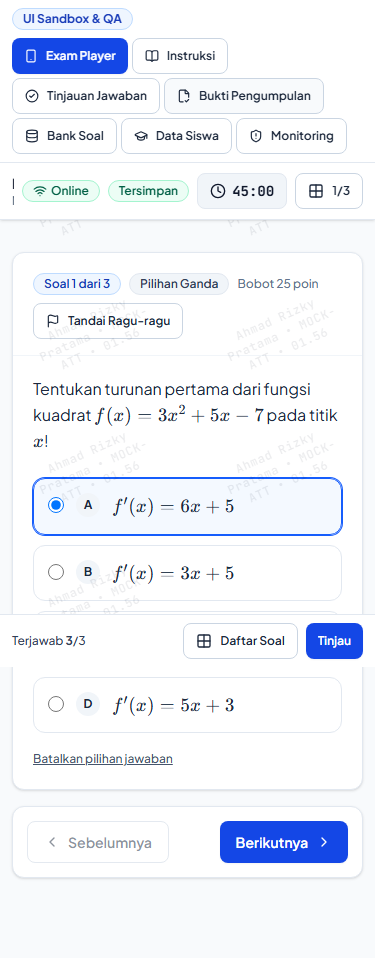
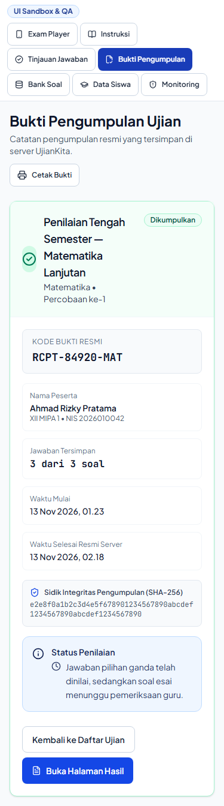
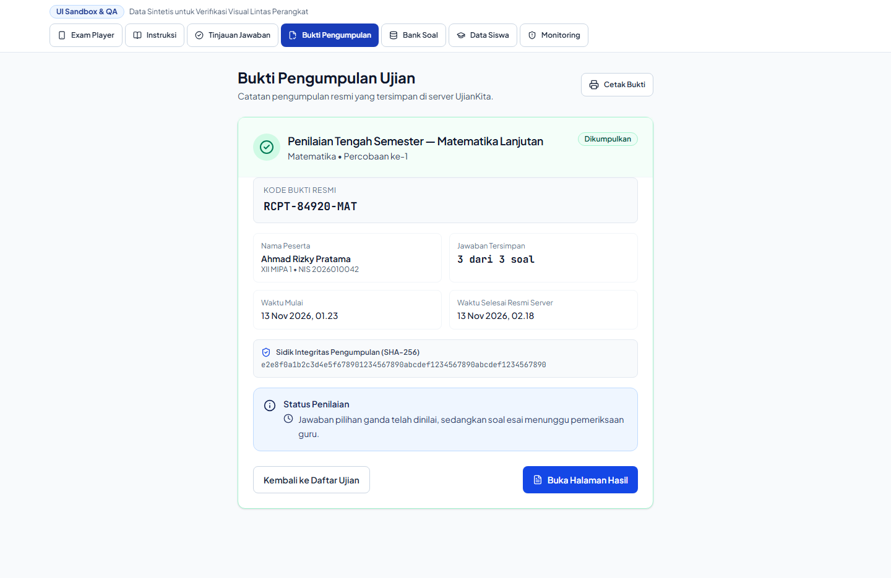

# Visual Comparison Contact Sheet: Student Instructions, Review & Receipt

This contact sheet presents side-by-side visual comparisons of the pre-examination and post-examination student flows:
1. **Pre-Exam Instructions (`StudentExamInstructions`)**
2. **Pre-Submission Answer Review (`StudentAttemptReview`)**
3. **Official Submission Receipt (`StudentSubmissionReceiptView`)**

---

## 1. Student Exam Instructions (375px vs 1440px)

### Mobile 375px Comparison

| Baseline Instructions (375px) | Redesign Instructions (375px) |
| :---: | :---: |
|  |  |

### Desktop 1440px Comparison

| Baseline Instructions (1440px) | Redesign Instructions (1440px) |
| :---: | :---: |
|  |  |

### Visual Deltas
- **Clear Readiness Cards:** Key exam parameters (Durasi, Jumlah Soal, Nilai KKM, Pengacakan) displayed in crisp 2-column or 4-column metric tiles with icons.
- **Rules & Honor Code:** Important CBT rules (larangan berpindah tab, pelarangan salin-tempel) formatted in structured bullet points with warning callout.
- **Start Button Callout:** Prominent primary start button with loading state indicator (`Mulai Ujian Sekarang`).

---

## 2. Student Answer Review (`/review`)

### Mobile 375px Comparison

| Baseline Review (375px) | Redesign Review (375px) |
| :---: | :---: |
|  |  |

### Desktop 1440px Comparison

| Baseline Review (1440px) | Redesign Review (1440px) |
| :---: | :---: |
|  |  |

### Visual Deltas
- **Honest Status Matrix:** Explicit breakdown of answers:
  - Total Soal
  - Sudah Dijawab (Emerald)
  - Ditandai Ragu-ragu (Amber)
  - Belum Dijawab (Rose/Neutral)
- **Direct Jump Links:** Clicking any question tile navigates directly to that question in the exam player.
- **Confirmation Guard:** Irreversible submission confirmation modal prevents accidental final submissions.

---

## 3. Official Submission Receipt (`/receipt`)

### Mobile 375px Comparison

| Baseline Receipt (375px) | Redesign Receipt (375px) |
| :---: | :---: |
|  |  |

### Desktop 1440px Comparison

| Baseline Receipt (1440px) | Redesign Receipt (1440px) |
| :---: | :---: |
|  |  |

### Visual Deltas
- **Tamper-Evident Receipt Badge:** Shows authoritative submission timestamp (WIB/UTC), submission fingerprint, and digital verification hash.
- **Printed Document Styling:** Print-optimized card design allowing easy physical printout or PDF export for school examination records.
- **Calm Reassurance:** Success header with checkmark icon eliminates student anxiety regarding whether their submission reached the server.
