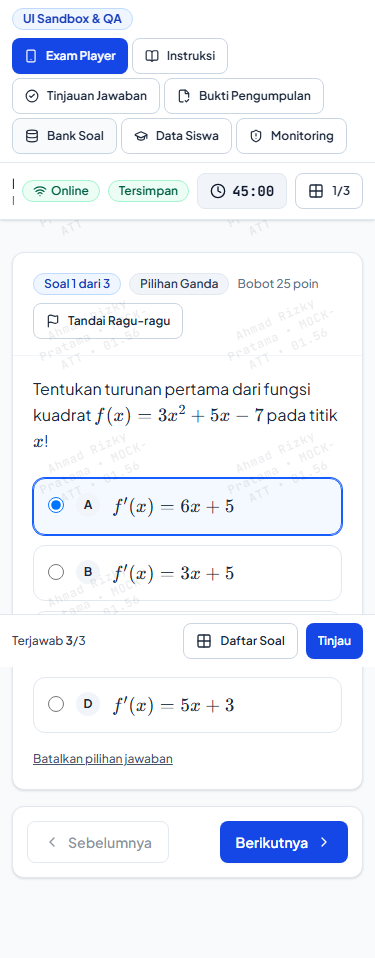
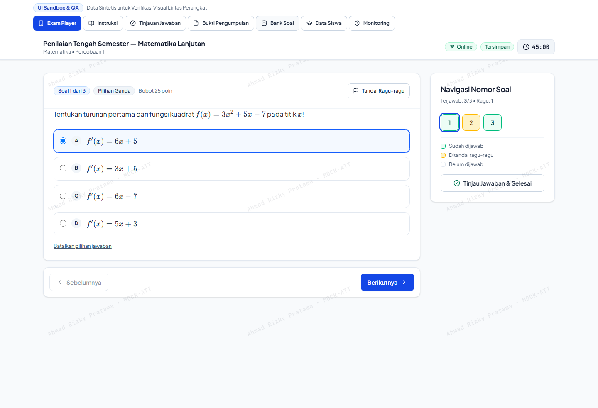
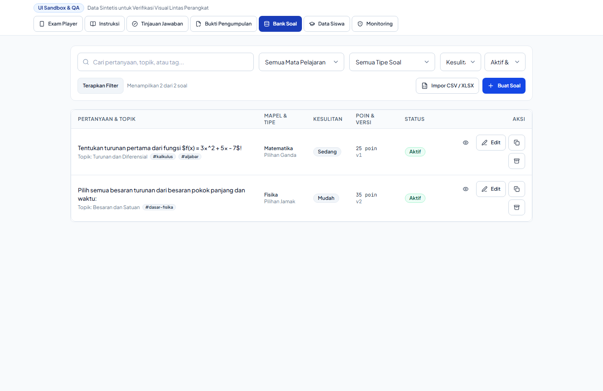
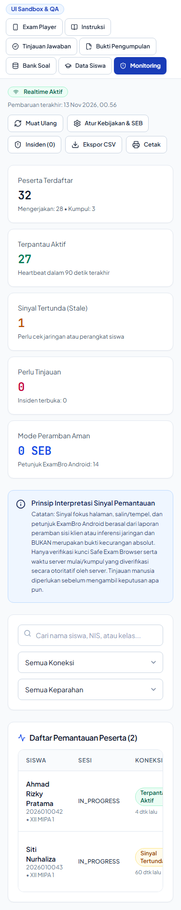
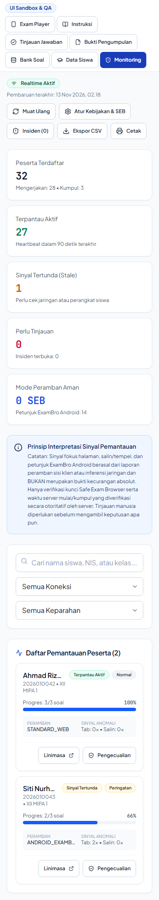
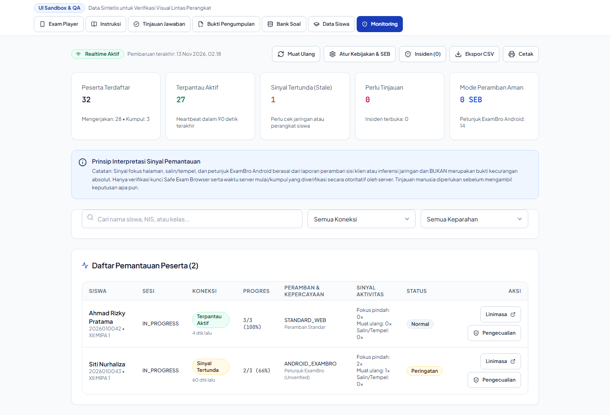

# Visual Comparison Contact Sheet: Teacher Management & Real-Time Monitoring

This contact sheet presents side-by-side visual comparisons of teacher-facing interfaces:
1. **Teacher Question Bank (`QuestionBankList`)**
2. **Teacher Real-Time Exam Monitoring Center (`TeacherExamControlCenter`)**

---

## 1. Teacher Question Bank (`QuestionBankList`)

### Mobile 375px Comparison (Responsive Table-to-Card Transformation)

| Baseline Question Bank (375px) | Redesign Question Bank (375px) |
| :---: | :---: |
|  |  |

### Desktop 1440px Comparison

| Baseline Question Bank (1440px) | Redesign Question Bank (1440px) |
| :---: | :---: |
|  |  |

### Key Improvements & Visual Deltas
1. **Responsive Card Transformation on Mobile (`< md`):**
   - **Baseline:** Standard HTML table overflowed horizontally on mobile screens, forcing teachers to scroll horizontally across 6 columns to find action buttons.
   - **Redesign:** On screens narrower than 768px, rows seamlessly transform into structured cards with:
     - Question stem snippet (2-line clamp)
     - Subject & type badges (`Pilihan Ganda`, `Esai`, etc.)
     - Difficulty & point badges (`Mudah`, `25 poin`, `v1`)
     - Large 44px action buttons for Edit, Duplicate, and Archive.
2. **Desktop High-Density Table (`md:block`):**
   - Clean tabular layout with crisp borders, topic tags, and aligned action columns.
3. **Filter & Search Bar:**
   - Unified search input and subject dropdown filter with accessible labels.

---

## 2. Teacher Real-Time Exam Monitoring Center (`TeacherExamControlCenter`)

### Mobile 375px Comparison

| Baseline Monitoring (375px) | Redesign Monitoring (375px) |
| :---: | :---: |
|  |  |

### Desktop 1440px Comparison

| Baseline Monitoring (1440px) | Redesign Monitoring (1440px) |
| :---: | :---: |
|  |  |

### Key Improvements & Visual Deltas
1. **Live Health Overview Tiles:**
   - 4-metric summary bar displaying:
     - Peserta Ujian (Total registered)
     - Sedang Mengerjakan (Active sessions)
     - Selesai / Terkumpul (Finalized)
     - Terputus / Insiden (Offline or security violations)
2. **Mobile Student Cards:**
   - Student session cards render live heartbeat indicators (`Online`, `Terputus`), progress percentage bar, and quick proctoring action triggers (Perpanjang Waktu, Reset Sesi).
3. **Incident Classification Badges:**
   - Color-coded security badges:
     - Hijau: Sesi Normal
     - Kuning: Peringatan Jaringan / Fokus Tab
     - Merah: Pelanggaran Keamanan / DevTools Terbuka
