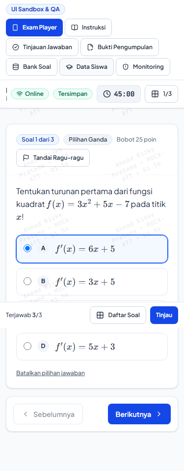
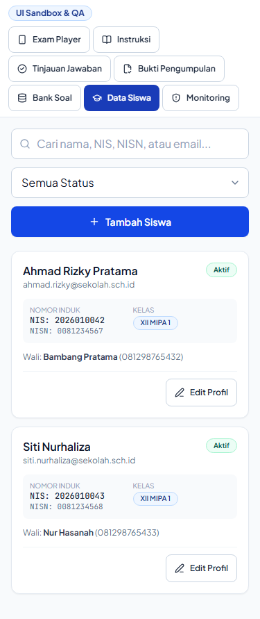
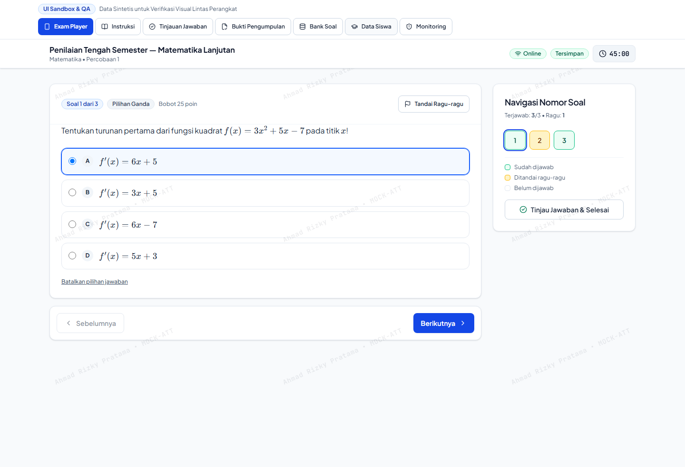
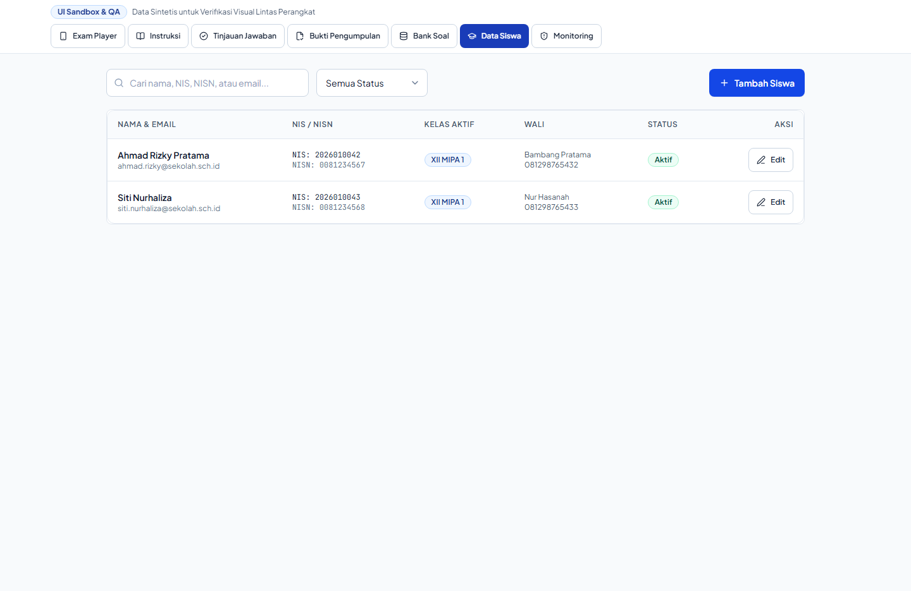

# Visual Comparison Contact Sheet: Administrator Management Interfaces

This contact sheet presents side-by-side visual comparisons of administrative school management interfaces:
1. **Students Manager (`StudentsManager`)**
2. **Teachers Manager (`TeachersManager`)**
3. **Classes & Subjects Manager (`ClassesManager` / `SubjectsManager`)**

---

## 1. Students Manager (`StudentsManager`)

### Mobile 375px Comparison (Responsive Transformation)

| Baseline Students Manager (375px) | Redesign Students Manager (375px) |
| :---: | :---: |
|  |  |

### Desktop 1440px Comparison

| Baseline Students Manager (1440px) | Redesign Students Manager (1440px) |
| :---: | :---: |
|  |  |

### Key Improvements & Visual Deltas
1. **Mobile Card Transformation (`< md`):**
   - **Baseline:** Table caused wide horizontal page overflow, hiding NISN, classroom, and action buttons.
   - **Redesign:** Compact student identity cards with:
     - Full student name and email
     - NISN badge (`NISN: 0012345678`)
     - Assigned class badge (`X MIPA 1`)
     - Edit and reset password action buttons with 44px touch targets.
2. **Desktop High-Density Data Table:**
   - Monospace font for NISN identifiers to prevent digit confusion (`0` vs `O`, `1` vs `l`).
   - Clean alternating row hover states.
3. **Batch Import & Export Callouts:**
   - Clear action triggers for CSV/Excel bulk import and export.
