# Visual Comparison Contact Sheet: Public Pages & Authentication

This contact sheet presents side-by-side visual comparisons of public-facing pages:
1. **Public Landing Page (`/`)**
2. **Login Portal (`/login`)**
3. **Forgot Password (`/forgot-password`)**
4. **404 Not Found Page (`/_not-found`)**

---

## 1. Landing Page (`/`)

### Mobile 375px Comparison

| Baseline Landing (375px) | Redesign Landing (375px) |
| :---: | :---: |
| 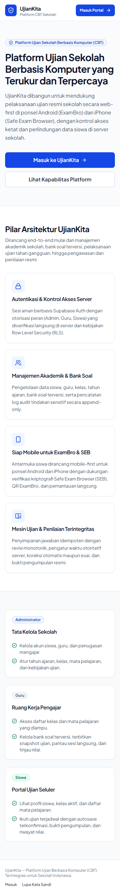 | 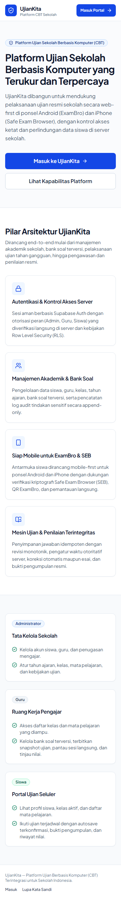 |

### Desktop 1440px Comparison

| Baseline Landing (1440px) | Redesign Landing (1440px) |
| :---: | :---: |
| 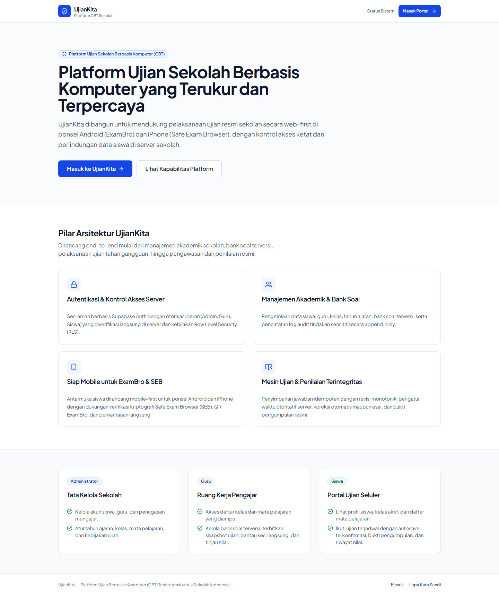 | 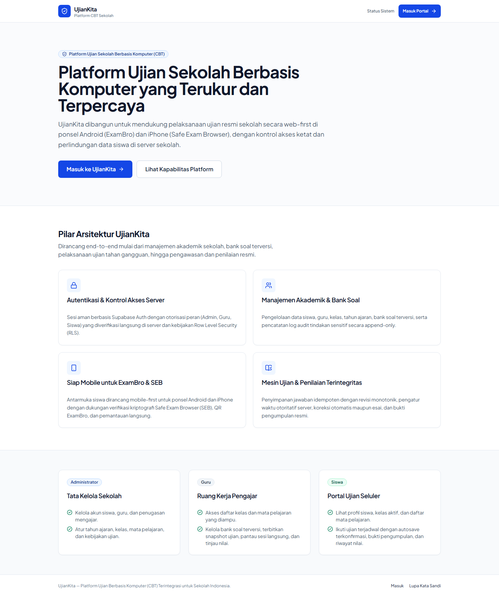 |

### Visual Deltas
- Professional Indonesian typography ("Platform Ujian Berbasis Komputer Modern untuk Sekolah Indonesia").
- Trust badges highlighting offline resilience, server-authoritative timer, and Safe Exam Browser compatibility.
- Responsive hero call-to-actions ("Masuk ke Portal Ujian").

---

## 2. Login Portal (`/login`)

### Mobile 375px Comparison

| Baseline Login (375px) | Redesign Login (375px) |
| :---: | :---: |
| 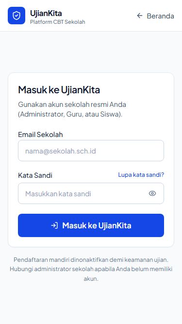 |  |

### Desktop 1440px Comparison

| Baseline Login (1440px) | Redesign Login (1440px) |
| :---: | :---: |
| 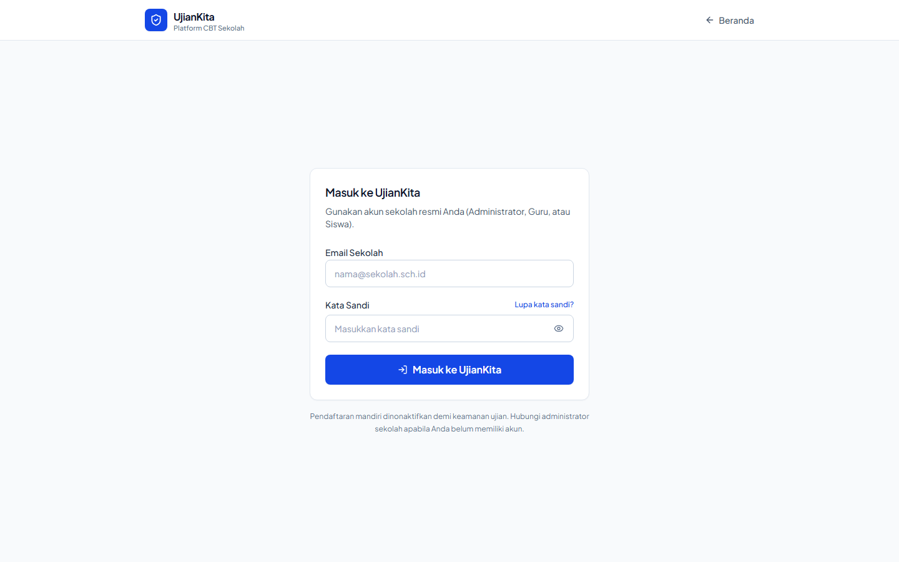 | 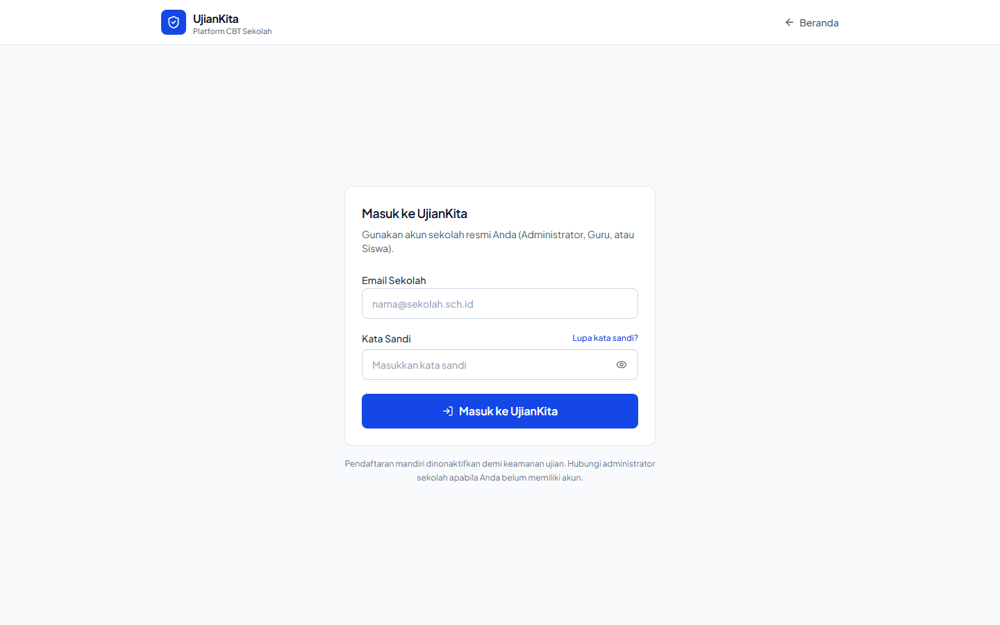 |

### Visual Deltas
- Responsive form inputs with 16px (`text-base sm:text-sm`) font size, completely eliminating iOS Safari auto-zoom behavior on focus.
- Clear error banner with honest Indonesian guidance when Supabase is unconfigured or credentials fail.
- 44px minimum tap targets on inputs, submit button, and forgot-password link.

---

## 3. Forgot Password (`/forgot-password`)

### Mobile 375px Comparison

| Baseline Forgot Password (375px) | Redesign Forgot Password (375px) |
| :---: | :---: |
| 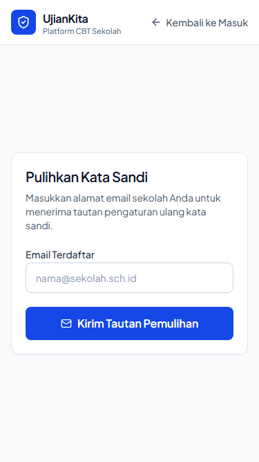 | 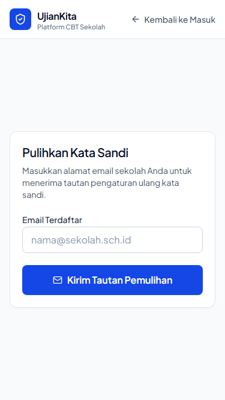 |

### Desktop 1440px Comparison

| Baseline Forgot Password (1440px) | Redesign Forgot Password (1440px) |
| :---: | :---: |
| 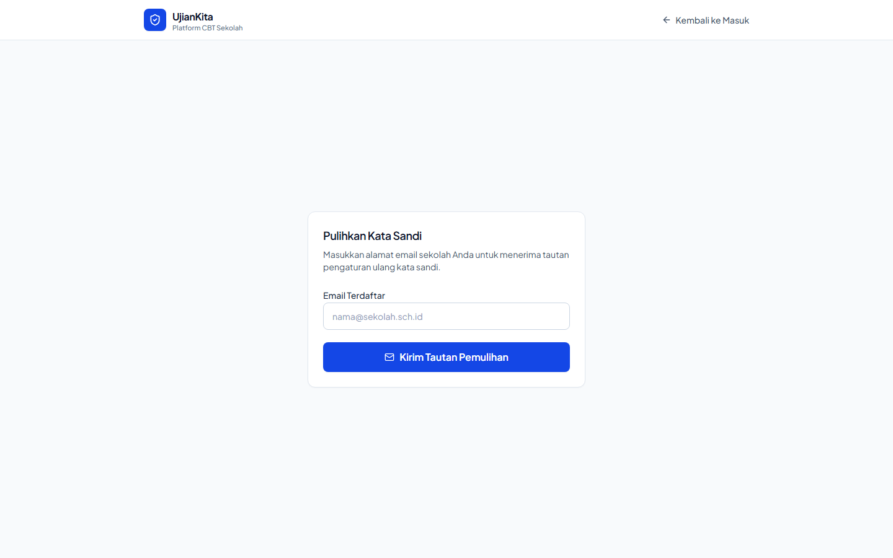 |  |

### Visual Deltas
- Centered card layout with clean back-to-login navigation.
- Accessible email input with explicit label and autofocus prevention.

---

## 4. Not Found Page (`404`)

### Mobile 375px Comparison

| Baseline 404 (375px) | Redesign 404 (375px) |
| :---: | :---: |
| 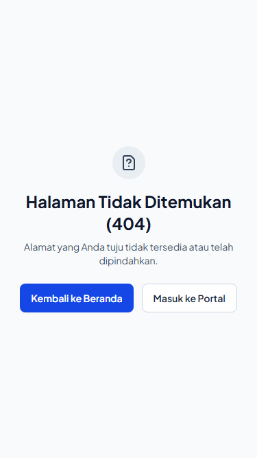 |  |

### Desktop 1440px Comparison

| Baseline 404 (1440px) | Redesign 404 (1440px) |
| :---: | :---: |
|  | 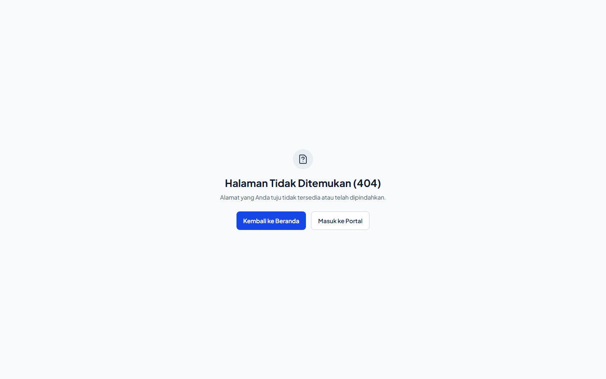 |

### Visual Deltas
- Helpful Bahasa Indonesia 404 recovery messaging with button link returning to `/login` or `/dashboard`.
- Clean error illustration that does not overflow mobile screens.
